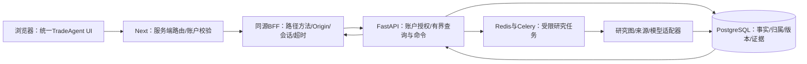

# TradeAgent前端架构与融合实施

更新：2026-10-08，Asia/Shanghai。首版研究平台范围已确认；组件/路径/API方案为后续实施约束，下表明确区分现有与待开发。待办的唯一维护清单见[开发计划](../01_项目总览/DEVELOPMENT_PLAN.md)，本文件不重复勾选任务。

## 产品架构与三来源分工

| 参考来源 | 实际融合区域 | 要实现的行为 | 当前完成边界 |
| --- | --- | --- | --- |
| Simply Wall St | 自有首页、Portal、关注公司、公司概览 | 概览到详情、研究与变化卡片、章节导航 | 首页为部分来源复刻；自有目录/关注为基础列表，可视化门户/公司详情未完成 |
| Fiscal.ai | 多期财务、趋势、后续行情与分析工具 | 周期选择、密集表格、指标图、单位/口径/来源、缺数据状态 | 未实现对应页面；当前后端年度切片不能支撑多期财务终端 |
| Quartr | 报告阅读、材料/证据库、引用原文核验 | 章节目录、报告正文、引用列表、并排片段、定位/高亮/返回 | 基础报告及来源元数据侧栏已实现；材料原文和完整核验交互未完成 |
| TradeAgent自有契约 | 账户、任务、预算、质量、论点和预测 | 所有权、受限执行、完整性、不可变版本、成熟度 | 账户和有界研究已完成；完整分析/论点产品化及真实资格未齐 |

最新设计采用用户已认可的[增强 A](FRONTEND_DESIGN_ENHANCED_A_20261008.md)，替代旧V2-B的Simply视觉主导规则。统一TradeAgent品牌、账户、语言、公司上下文、跨区域入口及公共状态；默认保留来源核心页面/内部导航与实测视觉token、字体层次、控件、密度和交互。公共层需验证不压缩表格/阅读空间、不重复导航或改变粘性行为，具体位置/尺寸待采样确认。首版不包含真实组合、收益/分红跟踪、券商同步或股票筛选器。

## 产品入口与来源参考隔离

- `/`：正式自有产品首页（待适配）。介绍已实现功能和开发状态，按钮进入自身注册/登录/工作台；演示使用可运行的自有页面，尚未具备能力不能用来源视频/数据规模/评级包装。
- 来源实测、组件规格、资产出处和纯复刻保留在clone-lab；拟将保留的页面放入明确的`/references/...`参考区域，标注参考/未完成复刻。正式导航不以它作为默认产品入口。该隔离路由尚未实现。
- 官网、应用导航、站内搜索、公司和研究CTA必须使用自身路由。未实现的业务功能隐藏或明确说明，不跳原站假装已完成。
- 已保存证据的真实来源外链可以保留，明确“外部来源”；这与原站产品CTA不同。安全HTTPS检查、不可访问提示、片段/全文范围需可见。
- Fiscal/Quartr尚未观察到的页面不能称1:1复刻；先补有界采样与组件规格，无法访问的部分标原创适配。已有来源复刻保存为独立参考，不覆盖已有账户或研究。

## 路由和用户对象

| 路由 | 对象与用途 | 状态 |
| --- | --- | --- |
| `/login`、`/register` | 自有账户 | 已实现，本地会话 |
| `/app` | 本人Portal，关注/任务/研究变化 | 基础目录和关注已实现，聚合门户待开发 |
| `/app/companies` | 公司目录、本人关注 | 拟定；当前嵌在/app |
| `/app/companies/{instrument_id}` | 公司概览、最近研究、章节入口 | 待开发 |
| `/app/companies/{instrument_id}/financials` | 财务期间/事实/指标/来源 | 待开发 |
| `/app/companies/{instrument_id}/market` | 合格行情/技术指标和来源资格 | 待开发，仅在对应数据契约/资格具备后启用 |
| `/app/research`、`/app/research/{run_id}` | 本人研究列表/提交、状态/预算/取消、报告 | 已实现有界基础；报告阅读待升级 |
| `/app/evidence`、`/app/evidence/{evidence_id}` | 本人有权读取的材料、片段、原文与返回引用 | 拟定，需携带/解析授权研究上下文 |
| `/app/theses`、`/app/theses/{thesis_id}` | 本人论点版本、反证、冻结预测/成熟度 | 待开发；内部基础不能直接当账户API |
| `/app/analysis/...` | 研究策略、回测或评估工具 | 后续稳定接口/资格后实施；无真实交易或组合承诺 |

使用instrument_id、research_run_id、evidence_id、thesis_id作为稳定对象地址。ticker为展示/时间相关解析属性；URL刷新和返回不依赖临时客户端状态。财务期间、模式、章节及引用采用可恢复的查询参数/锚点，其白名单在各增量规格定义。

## 技术模块与数据流

当前Next16/React19/strict TypeScript/Tailwind，运行仓库是`D:/桌面/ai-website-cloner-template`。`TradeAgent/apps/web`目前只有README。审查通过且素材/适配/产品验证具备后迁入pnpm工作区，不能把占位目录写成已运行应用。

复用现有账户会话和BFF。新增API先定义后端DTO与权限，再扩展精确代理白名单和类型化客户端；前端不直接连接数据库/模型/内部RAG或旧论点命令。读取no-store，写入Origin和服务器会话校验，输入/页长/响应/查询次数有界；会话和供应商凭据不进入客户端。

后续模块划分：

- 应用壳：TradeAgent导航、语言、账户、面包屑、移动菜单和共有空/错误状态。
- 门户/公司：关注、本人研究摘要、公司身份和章节索引；用户资料与公开公司信息分开授权。
- 财务：期间选择、表格、趋势、单位/精度/口径及来源弹层；计算与质量判定由后端负责。
- 研究：提交/任务/取消、预算和实际持久步骤；沿用当前有界轮询，离开页面停止。
- 阅读：章节、引用、材料列表、片段视图、定位/高亮；将选中evidence作为同一个阅读状态，不维护互相脱节的三份列表。
- 论点/预测：版本、支持/反证、预测条件和成熟度，严格区分研究意见和正式冻结预测。
- 分析工具：在稳定领域契约之后接参数与结果，不把模拟资格或图表等同真实业绩。

模块命名和目录在增量实现时确定；当前accounts/research组件和来源i18n可复用，迁出来源命名空间需保持语言偏好和首屏SSR。稳定查询/锚点与阅读位置支持刷新/返回，跨区域保持适用的公司上下文；账户切换/会话失效清除私有缓存。CSS、视觉token和采样资产独立，避免全局样式互相覆盖。共享账户/客户端/行为逻辑不能以牺牲来源控件效果为代价；原站实际提供的主题经采样确认后协调。新增UI遵守Tailwind、移动优先、命名导出和无any。

## 后端查询依赖（拟定，未作为现有API）

| 页面能力 | 需补的应用查询/命令 | 权限与数据边界 |
| --- | --- | --- |
| Portal/公司概览 | 账户摘要、公司详情、本人最近研究/变化 | 本人私有对象；公开公司事实可按来源许可共享，不泄露他人的研究和笔记 |
| 多期财务 | 期间序列、申报修订/口径、分部/KPI身份、确定性指标、原始申报定位和截止时间 | 财年/季度/TTM不混算，申报修订和当时可知规则保持；空值有原因 |
| 证据阅读 | 本人授权研究的材料/证据/片段、文档范围/位置/内容版本与有界检索 | evidence UUID不等于访问许可；不得从全局证据表绕过研究归属；不自动提升上传材料信任 |
| 论点跟踪 | 本人论点历史/版本/预测读取和受限写命令 | 不开放旧内部令牌接口；完整综合与冻结资格必须重验，历史不可变 |
| 变化与评估 | 明确时间点的版本比较、成熟观察与质量投影 | 首次/无历史/未成熟各自有状态；禁止回填或编造收益/准确率 |

具体URI/DTO/分页/预算在对应增量spec冻结。财务期间转成研究输入须由后端提交契约显式支持/校验，URL参数不改变Analysis Timestamp。不能直接扩大BFF白名单后宣称联调完成；新增账户能力必须覆盖未登录、他人对象、历史未归属对象与非法ID。

## 财务与阅读的可见验收

Fiscal融合：周期控件确实查询不同期间；单元格/指标有单位、来源、申报和可用时间；增长、现金流、债务、分部缺项分别说明。图表不将缺数画成0；季度/TTM需要确定性行为及独立来源资格，不靠前端重算。

Quartr融合：桌面章节/正文/证据分层，点击引用显示对应已保存片段，返回定位保持；手机使用可切换或分层的正文/证据面板。材料仅有片段时标范围，全文不可用明确提示。引用高亮对应真实保存文本，不凭模型生成原文。现有元数据侧栏只是基础。

门户融合：关注卡片、研究状态、缺口/变化都进入真实对象；没有净值/收益数据时不放虚构图表。信息图层次沿用已观测风格，证据完整程度不能作为公司投资质量评分。

## 产品状态与质量约束

所有模块有加载、空、输入错误、未登录/失效会话、404、无权对象统一不可见、后端不可用及重试状态。研究另有pending/running/failed/cancelled/insufficient_evidence/budget_exhausted；流程完成不等于complete_analysis。费用未知保留null/说明；不把订阅聚合0视为免费。

既有只读公司目录是开发测试记录，不等同全市场实时覆盖。来源资格、时间模式、回放限制、证据缺口、论点成熟度不能为了视觉效果隐藏。开启真实模型worker前仍须明确供应商、预算和资格；上线材料权利、公共拓扑隔离和P11部署另验收。

## 页面保留清单与代表页面确认

先形成公司概览、财务、报告/证据阅读三个代表页面的来源采样与对照方案。逐区域列出控件、展开/滚动/悬停状态、保留或调整理由、本地落点、现有API、缺口及资格。原站参考实现和产品适配分开保存；加入公共入口后再次验证宽高、粘性、移动端与视觉差异，效果经用户确认后扩展同类页面。

首页保留已确认的产品下拉、大标题与可切换展示、显式演示数据的期间/引用交互；导航细节、展示顺序、主题与Agent扩展位置仍待确认。Agent通过独立页面或确认后的扩展位置接入，不为加入任务/预算面板而重排来源核心页面。

首版缺口由前后端共同补齐，不用永久演示、删除控件或原站跳转代替完成。只借鉴可观察功能，不声称验证第三方私有后端；新的数据API订阅/真实来源资格不由设计认可自动获得。

## 持续更新与验收

每个开发增量链接开发计划的任务ID，先定义对应页面/APIspec，再实施和必要行为回归；真实PG/BFF、双语桌面/768/390、刷新/返回、独立Standards/Spec复审逐段验收。全产品验收包括无障碍、性能、对象主路径和失败恢复，来源视觉相似度不代替它们。

本次只是记录前端架构和已确认范围，没有完成Fiscal/Quartr页面、修正原站链接、迁移仓库或开启真实执行。继续开发从R1和FE-01/BE-01开始；上述未实现状态只在附有提交和验证后改变。
