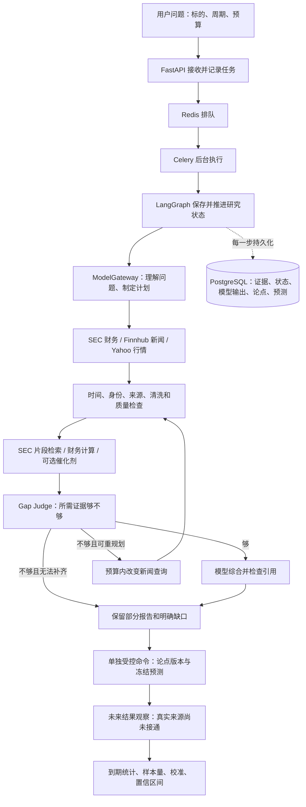

# P10 前实际进度、待办核验与架构说明

核验日期：2026-10-03（Asia/Shanghai）。代码基点：`913bb02`。
范围：冻结蓝图 v1.1.1、交接待办、阶段/Gate 文档、实际代码、普通测试、
现有 PostgreSQL 记录和一次有界真实研究。未进入 P10，未修改业务代码。

## 结论

目前是**已有可靠性基础、能采集真实资料并输出部分报告的后端研究工作台**。
完整真实研究、真实前向预测评估、真实历史策略验证及产品前端仍未完成。
P6–P9 的限定实现/模拟验证不等于整个冻结蓝图都已完成；不报告一个虚假的总百分比。

本次真实运行 `a307ea35-c1bf-46c8-bc35-efcbf96759a7` 收集了四项 SEC 财务事实、
八条新闻、九条英文关键词检索证据，并记录 43 根 Yahoo 行情，质量为 UNVERIFIED。
Intent 和 Planner 两个模型节点已完成；催化剂节点启动后出现受控 ValueError，
运行终止为 failed，没有催化剂结果或综合。错误根因尚未确认。
报告保留两项财务比例和部分解读，complete_analysis=false。

本次核验还补过了上轮缺失的真实数据库报告再生成，以及限定容器 HTTP 读取；
这关闭的是财务部分解读的数据库/HTTP 投影验证，不代表完整财务研究已完成。

## 实际阶段进度

| 阶段 | 现有实现 | 实际资格与剩余工作 |
| --- | --- | --- |
| P0–P1 基础与契约 | Python/FastAPI、严格数据契约、预算、工具链、Docker/CI 骨架 | 基础可用；CI 骨架不代表 Azure 部署 |
| P2 模型运行 | ModelGateway、Codex/Qwen/DeepSeek/OpenAI 适配、路由/重试/结构化输出 | Codex 当前真实理解/规划可用；其他 API 模型缺本机凭据；三供应商真实 Gate A 未齐 |
| P3 存储与任务 | PostgreSQL、Redis/Celery、任务租约、检查点、取消、补发 | 本次数据库/队列真实路径可执行；生产运维另待实现 |
| P4 行情与量化 | 永久证券身份、代码历史、行动模型、价格规范化、部分指标 | 真实 Yahoo 行情能获取但行动质量不合格；完整 V1 指标清单未实现 |
| P5 研究闭环 | 意图、计划、资料采集、RAG、缺口判断、受限重规划、条件综合、部分报告 | 真实采集可用；最新催化剂试跑失败；完整业务分析、事件确认和真实综合未通过 |
| P6 证据/论点/预测 | 不可变证据、论点版本、冻结预测、受控写入命令 | 存储与模拟流程已验证；4 条现存预测全部是测试记录；研究图未自动读取/更新论点历史 |
| P7 安全 RAG | 解析/清洗/扫描/隔离、FTS/pgvector、混合排序、受控接口 | 真实 SEC 有界片段和英文关键词检索通过；真实语义/跨语言效果未验证 |
| P8 回放与评估 | 时间过滤回放、预测结果存储、成熟度/校准统计、到期任务 | 普通/数据库/限定 HTTP 验证通过；无真实观察源和成熟样本，结果表为 0 行 |
| P9 策略/回测/风控 | 单标的均线策略、持仓或现金模拟、拆股/分红、成本、风险意向 | 仅模拟数据资格；无真实历史完整数据资格；策略指标仍为最小集合；无策略 HTTP 接口 |
| P10 前端 | `apps/web/README.md` 占位，已有策略文档 | 正式 UI 尚未实施 |
| P11 Azure | Dockerfile、Compose、质量检查流水线 | 云资源、密钥管理、监控、云端一致性资格尚未实现 |

## 所有当前未完成事项的逐项核验

“通过”只指下表注明的范围；“未能验证”保留为待办，不视作完成。

| 编号 | 项目 | 本次核验结果 | 仍需完成的具体条件 |
| --- | --- | --- | --- |
| 01 | SEC 联系配置与真实财务获取 | 已关闭旧卡点；配置存在，最新真实运行取得四项事实 | 多期/季度/现金流等完整财务分析另开发 |
| 02 | 财务部分解读的数据库再生成 | 通过；两份真实旧记录重算并保留精确来源 UUID，JSON 往返通过 | 本范围无新增阻塞；不扩展为增长/估值/流动性结论 |
| 03 | 财务解读的 HTTP 投影 | 当前源码只读挂载到临时非 root API 容器，读取真实旧报告通过 | 尚未验证新镜像构建/正式部署；旧报告完整性仍 false |
| 04 | 完整业务/财务分析 | 未完成；现有四概念事实、两个比例与当期利润描述 | 增长、盈利结构、现金流、债务、分部/行业等需限定设计和真实来源验收；完整报告准入需开发 |
| 05 | 公司行动正式材料 | 仍缺；用户此前已明确没有 Daily List 订阅/导出，不重复索取 | 合法全窗材料、日历/基线/修订/空日语义、来源认证与独立金例 |
| 06 | 公司行动导入与资格 | 材料审计函数/离线 CLI 和失败关闭测试存在；不是正式解析器/合格 provider | 实际解析、来源链、范围契约、行动导入与价格单位核对；不能改 Yahoo 为合格 |
| 07 | 当前行情/技术证据 | 最新能获得 43 根行情；UNVERIFIED，被指标门槛拒绝 | 完整行动覆盖与价格质量资格；实际市场/量化证据目前不能进综合 |
| 08 | 完整 V1 技术指标 | 未齐；目前有 close、单期收益、SMA20、EMA20、RSI14、20 期波动率与趋势斜率 | 蓝图 §20 的 MA5/10/50、成交量均值/量比、MACD、ATR、距均线、趋势状态、支撑/阻力等及独立金例 |
| 09 | 真实非空催化剂解释 | 最新运行未通过；先前仅有真实合法空输出，非空解释仍只有模拟资格 | 先诊断最新失败，再用真正适用的来源验证；不为了非空输出编造事件 |
| 10 | 完整真实综合 | 未通过；最新无 Synthesis，已有模拟完整路径 | 市场/量化资格、计划所需证据及分析完成规则满足后，验证真实综合、引用和论点预测链 |
| 11 | 更广泛重规划 | 泛化能力未齐；现实现只对支持查询的 News loader 重规划 | Finnhub 当前快照未注册成可查询重规划器；财务/行情/RAG 失败改道与其他来源需单独开发 |
| 12 | 英文关键词 RAG | 已关闭旧卡点；本次 PostgreSQL lexical/PIT/标的隔离/不可变/NULL 配对探针通过，最新真实研究有九条证据 | 不是语义检索或完整申报覆盖；官方导入目前是有界片段 |
| 13 | 真实语义/多语 RAG | 未能验证；embedding endpoint/key/model 均未配置；schema 固定 384 维 | 选择兼容来源或正式迁移维度、分块和索引，再做真实语义/跨语/误召回金例；lexical 模式不依赖它 |
| 14 | 更完整研究能力与记忆回流 | 部分未实现；Bull/Bear 是同一综合输出字段，没有独立 Critic 节点；行业/宏观、previous/current thesis 是预留字段 | 明确 V1 范围，接入论点历史检索和研究更新；需要的行业/宏观/申报分析与独立审查能力另实现 |
| 15 | 真实前向预测积累 | 未开始；四条数据库预测逐条溯源均为 gate_c_fixture 行情和 deterministic-mock 模型 | 从合格真实研究冻结新的预测，不能把模拟记录或历史回填算作真实前向样本 |
| 16 | 真实结果观察适配器 | 未实现/配置；当前 source 读取人工/外部已持久化观察，而非自动抓取合格市场/基准结果 | 合格结果/基准提供器、窗口/时间/来源资格与部署配置 |
| 17 | 到期评估和防重复 | 限定数据库探针通过：模拟观察首次产出 1 个 Outcome，第二次 0 个；观察与结果 UPDATE/DELETE 均被拒绝 | 模拟事务全部回滚、正式表仍 0 行；真实任务仍默认关闭，需上述观察来源和明确期限规则 |
| 18 | 评估 HTTP 与成熟度 | 临时容器 GET 通过：测试 cohort 1 条预测/0 条结果、10 个桶、准确率 null、exploratory；未知 cohort 返回 404 | 该测试配置未写入正式配置；真实 cohort 仍 0 个；真实成熟度/预测质量不成立 |
| 19 | 历史回放/真实历史 Alpha | 回放模式隔离和时间过滤普通测试通过；无真实历史 LLM Alpha 资格 | 保存当时真实可见预测/信号及完整历史数据；当前模型重讲过去不算严格回测 |
| 20 | 真实历史策略资格 | 未通过；现有单标的持仓/现金回测只经模拟金例 | 合格历史证券池、行情、行动、价格单位和生命周期覆盖，不能用现今证券池回填过去 |
| 21 | 完整策略绩效指标 | 只有总收益、最大回撤、每 bar 波动率、交易数、佣金 | 蓝图 §38 的 CAGR、Sharpe/Sortino、胜率、盈亏比、平均盈亏、换手、基准超额/暴露等尚未齐 |
| 22 | UI 所需后端接口齐备程度 | Research 状态/报告/取消、受控 RAG/论点写入、评估读取有 HTTP；回测/风控是 Python 模块 | 论点历史/证据浏览/策略回测等产品查询接口尚需明确；无 SSE，只能现有状态轮询 |
| 23 | 完整监控与版本追踪 | 检查点、来源尝试和成功模型元数据已有；attempt tracer 主要在内存 | 未发现 OpenTelemetry/Langfuse 集成或版本化 prompts 实现；prompt/graph 版本、失败诊断和持久化 trace 展示待补 |
| 24 | 完整模型额度/费用计量 | 未通过；订阅适配器 token/费用为未知，聚合字段的 0 是占位 | 不报告“免费/零费用”或可严格核算 token/金额预算；失败尝试也需清楚区分于已完成节点数 |
| 25 | API 多供应商真实 Gate A | 未能验证；本机 Qwen/DeepSeek/OpenAI key、Alpha Vantage key 均未配置；相应适配代码/离线测试存在 | 有明确配置和额度后各供应商真实调用；不把 Codex 成功当作其他模型已通过 |
| 26 | 持续模型红队/结构性隔离资格 | 已有扫描器/严格 schema/上下文隔离回归；13 类恶意 fixture 检测不代表永久模型安全 | 真实模型的持续攻击/误报指标、完整权限与凭据边界独立探针仍需验收；不以扫描通过覆盖所有安全要求 |
| 27 | P10 前端、P11 云部署 | 尚未开发；前端只有占位；Azure 只有 CI 骨架 | 产品路由、组件/端到端/无障碍/性能验证；ACR/Container Apps/PG/Redis/Key Vault/监控及云本地一致性另做 |

全市场扫描、真实券商下单、自动交易、SaaS/计费/多租户并非当前 V1 待补功能。
扫描器属于 Future；券商和自动交易被蓝图明确排除，不把这些范围外内容算作缺陷。

## 本次新增发现：需要先处理的工程问题

1. **最新真实催化剂运行失败。** 数据库保留 catalysts_started 和 started 尝试标记，
   最终为 failed/ValueError；没有 assessment。受控错误没有保存具体业务校验原因，
   本次没有足够证据断言是模型内容、引用校验还是其他 ValueError。
   已完成节点计数为 2，不代表催化剂未请求或实际消费只有两次。
2. **催化剂失败标记没有被收尾。** `graph/workflow.py::failed_research_state` 的节点枚举
   未包含 CATALYSTS，已失败运行的该标记仍是 started。安全终止/禁止重试仍存在，
   但可观察状态不准确，需要修复与回归。
3. **催化剂模块有导入顺序依赖。** 在干净进程单独 import
   `backend.app.news.catalysts` 可复现 circular ImportError；正常 API/worker 导入通过。
   是模块组织问题，不能把它当作本次真实运行失败的已确认根因。
4. `/health` 的 milestone 仍硬编码 phase-7。该接口能检查进程可响应，
   不能证明数据库、来源、研究完整性或项目进度；应更正元数据或去除阶段含义。

以上为核验发现，**本轮未修改或修复业务代码**。优先处理 1–3，复验后再宣称相关
路径稳定。此前阶段的零审查问题不是对任意未来真实输入的成功保证。

## 一次研究实际怎么运行

API 是任务接待窗口；Redis 是排队单；Celery 是后台工作人员；LangGraph 是按步骤
执行并记进度的流程表；PostgreSQL 是长期档案室。模型用于理解和文字综合，
数值计算、来源资格、回测和风险判断由代码完成。模型提供商通过同一网关接入，
不会让业务逻辑直接绑定某个模型会话。

资料先检查“是不是这只证券、当时是否可知、来源可靠吗、有没有恶意指令”，
再成为证据。模型引用必须指向实际证据，财务比例由原始数字重算。
引用一致性只证明归因，不证明模型解读正确。

当前真实路径常见的结果是“资料收到了，但行情调整完整性不够，因此不给合格
技术指标和完整综合”。最新还叠加了催化剂节点失败。前端将来必须能显示这些状态。

## 功能如何分工

- **研究提交与取消：** `POST /research`、状态/报告 GET 和 cancel；collection_only
  可以只采集而不请求模型规划。任务先保存再排队，失败、取消与预算终止可查。
- **证券与行情：** 永久 instrument_id 防止证券改代码后串数据；分红/拆股模型与
  价格口径分开。当前研究在采集后冻结截止时间，历史研究不能把今天才获取的
  内容假装成过去已知。
- **财务与新闻：** SEC 提供四项年度 USD 事实；报告重算净利率与现金/资产占比。
  Finnhub 保存清洗后的标题/摘要；新闻报道、来源解释与确认事件严格区分。
- **RAG：** 官方片段入库后按证券、时间、信任与扫描版本过滤。英文关键词路径
  已真实可用；向量及混合排序有实现，但没有真实语义服务/效果资格。
- **研究记忆：** 证据不可覆盖，论点新版本保留旧历史，预测冻结后不能改写。
  当前主要是存储和受控命令能力，尚未成为研究图自动使用的记忆反馈闭环。
- **回放与评估：** 可以用截止时刻之前的已存证据回放；现代模型自身可能知道
  后来信息，因此必须标明风险。真实预测要等待期限后接入结果再算统计。
- **策略与风控：** 当前是独立的单标的均线策略/回测库。它检查数据质量、持仓、
  现金、止损风险、亏损、流动性、价格偏差、交易时段与总开关，最多产出需要
  外部授权的 TradeIntent。没有券商执行代码。
- **质量门槛：** 综合数据质量、证据覆盖、回放风险、成熟度与安全/完成状态。
  模型给出的概率不是系统可信度；流程 complete 也不等于完整业务分析报告。
  目前 ResearchReport.complete_analysis 固定 false，正式完整报告规则尚待实现。

## 本次验证证据与复验边界

- 全量普通检查：**411 passed、1 skipped，90.16% coverage**；Ruff、strict mypy
  **97 个源文件**通过。跳过的是显式启用的真实模型 Gate A；覆盖率不是产品完成率。
- 恢复已有 Docker Desktop，启动原来的 postgres/redis 容器和数据卷；未新建或替换
  正式数据库。migration 为 **0014_rag_lexical_only**，两服务最终 healthy。
- 核验前库中 28 个 research_run、118 条 evidence、23 条 model_execution、5 个
  RAG document、43 个 chunk。模型 provider 标签不能单独判定真实调用，部分
  历史测试记录虽写 codex_subscription，model 实际是 deterministic-mock。
- 4 条 Forecast 均逐条确认来自测试证据/模型；OutcomeObservation/Outcome 都是 0 行。
  没有真实成熟样本；不提供预测准确率/历史 Alpha/真实策略收益。
- 真实旧运行 `78e1521e-38cf-451b-b6a6-2c72fe78b7b5` 和
  `8f880203-4026-4f06-9b29-1fd7c4e1e754` 的报告再生成、精确指标引用与 JSON 往返通过。
- PostgreSQL lexical 查询、PIT、跨证券隔离、直接修改拒绝、embedding/model NULL
  配对检查通过；全部探针 fixture 回滚。
- Outcome 探针使用既有模拟预测、临时五天期限/现金基准规则与模拟收益：一次写入、
  零写入重试、观察/结果 UPDATE 与 DELETE 拒绝、cohort 读取通过；所有写入回滚，
  并确认两结果表仍为零行。没有改变正式评估策略或制造真实业绩。
- 临时 API 容器使用现有镜像、当前 backend 源码只读挂载、临时 cohort 配置和随机
  loopback 端口；只做 GET。正式配置未改，容器已移除。这是当前代码容器 HTTP
  读取资格，不是重新构建镜像、生产部署或真实结果采集资格。
- 最新真实探针使用 `--financials --rag-lexical --catalysts`。命令实际 flag 是
  **--rag-lexical**，早期交接中的 --rag 不是当前解析器选项。探针只管理其自有
  API/worker，完成后已关闭；没有重新投递失败的催化剂调用。
- 最新运行的 budget_usage 包含 5 个 tool call、2 个完成模型节点、8 个新闻文档、
  9 个 RAG chunk。token/cost 的聚合零值不证明零消费；催化剂完成结果未持久化。
- 干净进程模块加载检查：10 个入口中 9 个通过，news.catalysts 单独导入失败。
  全量测试的成功不能替代这项独立加载检查。

诊断 JSON 保存在 Windows Temp，仅含配置是否存在和有界结果，不含密钥/联系方式：
`tradeagent-pre-p10-read-audit-20261003.json`、
`tradeagent-pre-p10-outcome-probe-20261003.json`、
`tradeagent-pre-p10-http-probe-20261003.json`、
`tradeagent-klac-current-model-durable.json`。正式结论以本文为准，临时文件可被后续覆盖。

## 下一步顺序

1. 诊断并修复催化剂失败、失败状态收尾和循环导入，留下真实失败/恢复回归证据。
2. 对照完整蓝图确认 P4/P5/P9 的剩余 V1 范围，补指标、研究/记忆能力、策略统计及
   产品所需接口；不能仅按早期“阶段完成”记录跳过这些差异。
3. 公司行动当前来源资格仍待正式材料；同时可继续开发限定解析/导入衔接，保留门槛。
4. 真实综合可用后开始真正前向预测积累、接入结果观察并持续评估。样本成熟需要时间，
   不用回填或模拟数据代替。语义 RAG 是独立可选扩展，不阻塞现有关键词路径。
5. 上述核验不自动启动 P10；进入时再由用户安排范围。前端可呈现部分/不足/失败状态，
   但不能借 UI 发布将未验证能力标成合格。Azure 属于后续 P11。

## 核验依据

- 冻结蓝图：`AGENTIC_EQUITY_RESEARCH_WORKBENCH_B_FINAL_V1_1_1_OPERATIONAL_RELIABILITY.md`
  §6、§20、§38、§47–50、§56–59。
- 现状：`backend/app/main.py`、`api/`、`graph/{workflow,evidence_gap,synthesis}.py`、
  `financials/`、`news/catalysts.py`、`quant/indicators.py`、`rag/`、`persistence/`、
  `evaluation/`、`strategy/`；`apps/web/README.md`、Dockerfile、azure-pipelines.yml。
- 历史限定资格：PHASE5–PHASE9_WORKFLOW、各 Gate qualification、
  SEC_CURRENT_QUALIFICATION、RAG_LEXICAL_QUALIFICATION、FINANCIAL_CATALYST_QUALIFICATION、
  FINANCIAL_PARTIAL_ASSESSMENT_REVIEW。早期“尚未接入”条目须由后续真实记录修正。
